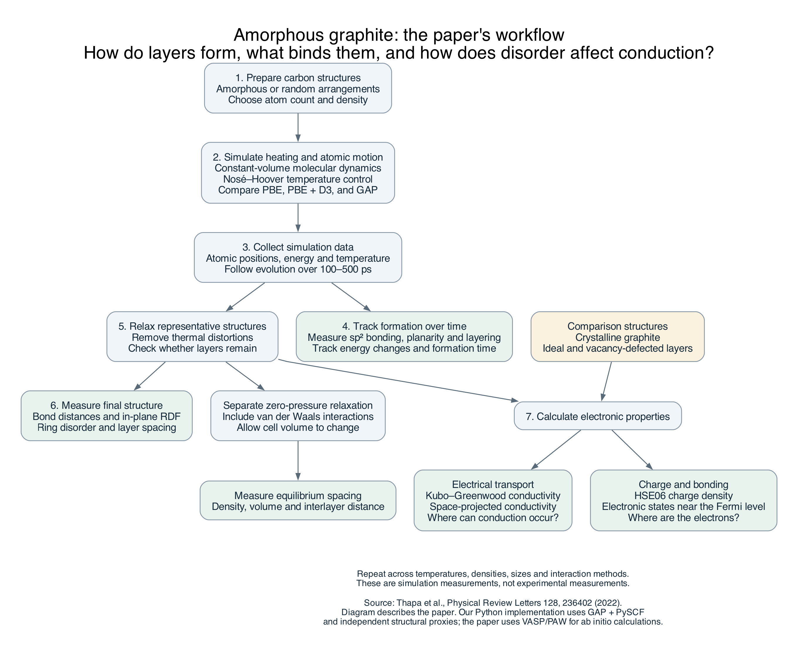

# Paper workflow: what is measured and how

Source: [Thapa et al., PRL 128, 236402 (2022)](https://doi.org/10.1103/PhysRevLett.128.236402).
These are simulation measurements. a-C denotes amorphous carbon, a-G amorphous
graphite, and c-G crystalline graphite.



The main question is whether disordered carbon forms graphite-like layers, what
contributes to binding those layers, and how ring disorder changes conduction.
Initial density, temperature, system size and interaction method are varied;
atomic trajectories and electronic calculations supply the measured quantities.

| Scientific question | Measurement | Analysis | Paper location |
|---|---|---|---|
| Do layers form? | sp² bonding and layering | Analyze bonding/geometry; the paper's criterion combines >95% sp² with layers | Figure 1 |
| How does formation proceed? | Planarity, energy and formation time | Track trajectories, layer membership and energy changes | Figure 2 |
| How disordered are the layers? | In-plane RDF, ring topology, spacing | Analyze pair separations, nonhexagonal rings and neighboring planes | Figure 1 |
| How favorable is the structure? | Energy difference per atom | Compare consistently calculated PBE energies with c-G | Main text |
| What contributes to interlayer binding? | Charge between planes, band-resolved densities | HSE06 density slices and states near the Fermi level | Figures 3–4 |
| How does disorder affect conduction? | Conductivity and spatial contributions | Kubo–Greenwood/SPC with crystalline and defect comparisons | Figure 5 |
| What spacing is preferred without fixed volume? | Relaxed spacing and density | Zero-pressure relaxation including van der Waals interactions | Main text |

The diagram's arrows describe data flow, not proof that every simulated initial
state must become layered. Our software's method substitutions and analysis
choices are listed in [METHODS_AND_LIMITATIONS.md](METHODS_AND_LIMITATIONS.md).

Regenerate the diagram if Graphviz is installed, from the repository root:

```sh
dot -Tpng paper_workflow.dot -o paper_workflow.png
```
